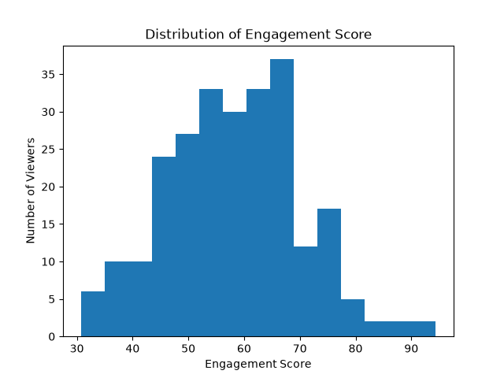
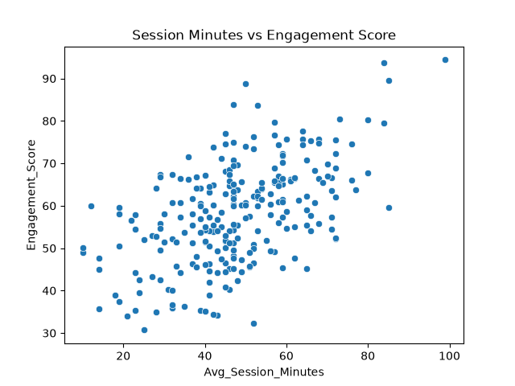
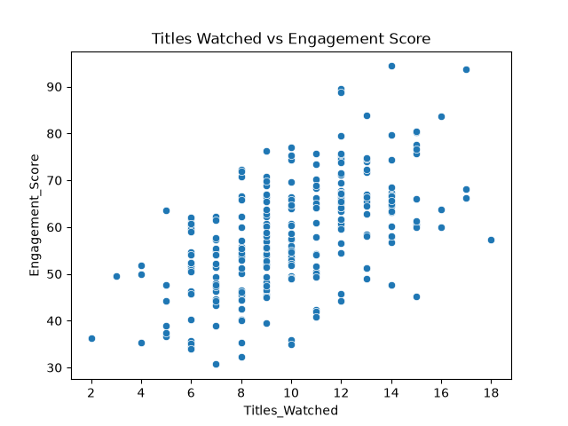
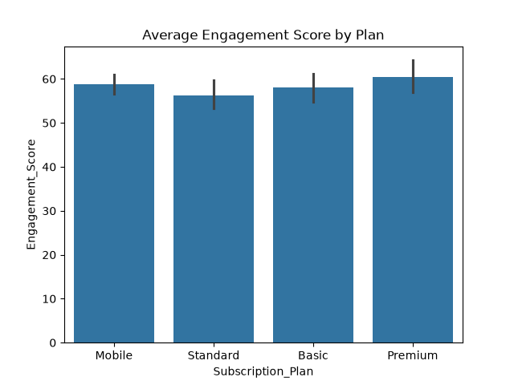
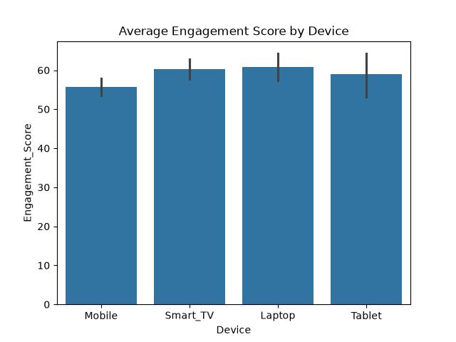
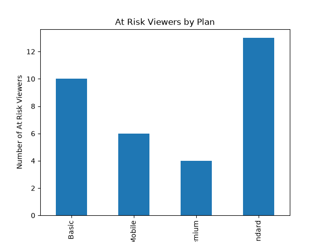

# OTT Viewer Engagement Analysis
 
A beginner data analysis project in Python (pandas, NumPy, matplotlib, seaborn) on movie/OTT viewing data.
 
## Business Problem
 
An OTT streaming platform's product team wants to know what drives viewer engagement. Some subscribers watch a lot and stay active, while others barely use the service and may cancel. The team needs to find which viewing habits and user groups are linked to higher engagement, and which viewers need attention.
 
## Dataset
 
- File: `data/raw/ott_data.csv` (synthetic, computer-generated data, no real people)
- Size: 255 rows (250 unique records plus duplicates) and 11 columns
- Cleaned file: `data/processed/ott_data_clean.csv`
### Data Dictionary
 
| Column | Data type | Meaning | Valid values / range |
|---|---|---|---|
| Viewer_ID | text | Unique viewer code | V1001 to V1250 |
| City | text (category) | Viewer's city | Delhi, Mumbai, Bengaluru, Lucknow, Pune |
| Subscription_Plan | text (category) | Plan the viewer pays for | Mobile, Basic, Standard, Premium |
| Device | text (category) | Main device used for watching | Mobile, Smart_TV, Laptop, Tablet |
| Preferred_Genre | text (category) | Genre watched most | Drama, Action, Comedy, Thriller, Documentary |
| Age | integer | Viewer's age in years | 16 to 60 |
| Avg_Session_Minutes | integer | Average length of one viewing session | 10 to 120 |
| Titles_Watched | integer | Movies/episodes started in the month | 1 to 30 |
| Buffering_Incidents | integer | Buffering/playback complaints in the month | 0 to 15 |
| Last_Active_Date | date (YYYY-MM-DD) | Last day the viewer was active | within the last 2 years |
| Engagement_Score | decimal | Overall engagement (higher is better) | 0 to 100 |
 
## Questions
 
1. What does `Engagement_Score` look like overall?
2. Do `Avg_Session_Minutes` and `Titles_Watched` affect `Engagement_Score`?
3. Does `Engagement_Score` differ by `Subscription_Plan`, `Device`, `City` or `Preferred_Genre`?
4. Which viewers need attention? (`Engagement_Score` below 45 = "At Risk")
## Steps Followed
 
1. Loaded the raw data and inspected it (head, info, describe, missing values, duplicates, category values)
2. Cleaned the data (duplicates, inconsistent text, impossible values, missing values)
3. Created new columns: `At_Risk`, _(add your other new columns here)_
4. Answered each question with tables and charts
5. Wrote insights and recommendations
6. Saved the cleaned file
## Data Cleaning Summary
 
_Write in your own words what problems you found, how you fixed each one, and why._
 
| Problem found | How many | How I fixed it | Why |
|---|---|---|---|
| | | | |
| | | | |
| | | | |
| | | | |
 
## Key Findings
 
_Replace the blanks with numbers from your own data._
 
1. The average engagement score is ___, with scores ranging from ___ to ___.
2. Session minutes and engagement score have a correlation of ___. Titles watched and engagement score have a correlation of ___.
3. The group with the highest average score is ___ (___), and the lowest is ___ (___).
4. ___ viewers (___%) are At Risk. Most of them are on the ___ plan / use ___ device.
 
## Charts
 






 
## Project Structure
 
```
ott-viewer-engagement-analysis/
├── data/
│   ├── raw/ott_data.csv
│   └── processed/ott_data_clean.csv
├── notebooks/ott_analysis.ipynb
├── images/
├── requirements.txt
└── README.md
```
 
## How to Run
 
```bash
pip install -r requirements.txt
jupyter notebook notebooks/ott_analysis.ipynb
```
 
Run the notebook cells from top to bottom. The cleaned file and charts are saved automatically.
 
## Tools Used
 
Python, pandas, NumPy, matplotlib, seaborn, Jupyter Notebook

##  My Info

**Name:** Saksham Bansal
**Admission No:** 2026B01011122